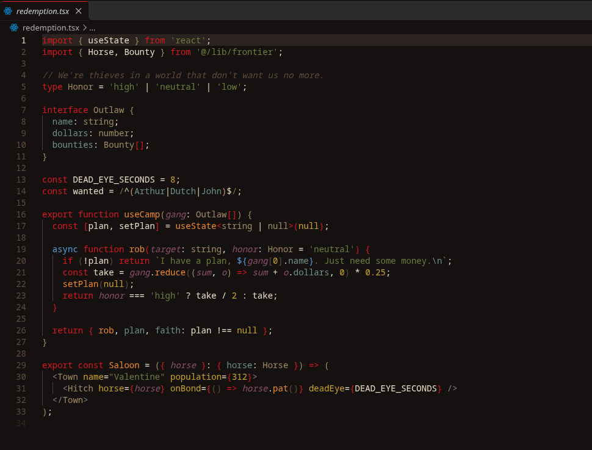

# Redemption Theme

Outlaws, gunsmoke and worn leather from the Wild West.

A dark VS Code theme inspired by Rockstar Games' **Red Dead Redemption 2**.



## Install

Search for **Redemption Theme** in the Extensions view, install it, then pick **Redemption** with *Preferences: Color Theme*.

Or get it from the [VS Code Marketplace](https://marketplace.visualstudio.com/items?itemName=yyg27.redemption-vscode-theme).

You can also install it by running this command in any terminal, including the one inside VS Code:

```
code --install-extension yyg27.redemption-vscode-theme
```
